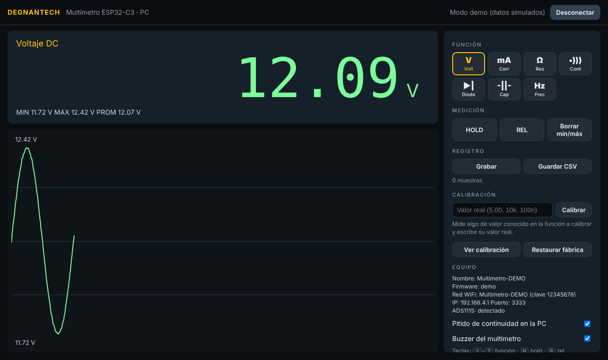

# Multímetro ESP32-C3 (OLED 0.42" integrada) + ADS1115, con app Android (Bluetooth y WiFi)

Multímetro de banco para electrónica de **baja tensión DC**, con **solo dos puntas** (roja y
negra), como uno comercial. La función se elige con el botón **MODO** o desde la app. Dos relés
llevan la punta roja al circuito correcto. La lectura sale en la pantalla OLED y en el teléfono
(Bluetooth LE o WiFi).

| Función | Rango aprox. |
|---|---|
| Voltaje DC | 0 – 40 V |
| Frecuencia (onda cuadrada de 3.3–5 V) | ~1 Hz – ~100 kHz |
| Resistencia (autorango 1k/10k/100k/1M) | 1 Ω – 10 MΩ |
| Continuidad (pita por debajo de 30 Ω) | — |
| Prueba de diodos (unos 2.5 mA) | Vf hasta ~3 V |
| Capacitancia (tiempo de carga RC, 2 rangos) | ~1 nF – 10 000 µF |
| Corriente DC | 0 – 300 mA (fusible de 315 mA) |

> ⚠️ **Seguridad.** Sin aislamiento ni categoría CAT. **Nunca** midas 110/220 V AC ni nada
> conectado a la red eléctrica. Úsalo solo con baterías, fuentes de laboratorio y circuitos de
> hasta 40 V DC.

---

## Archivos

```
multimetro-esp32/
├── diagrama.html        ← GUÍA DE ARMADO con dibujos (ábrela en el navegador)
├── docs/
│   ├── esquema-electrico.pdf / .png     ← esquema completo (hoja A3)
│   ├── diagrama-de-bloques.png
│   ├── montaje-placa-perforada.png
│   └── app-*.png                        ← pantallas de la app
├── imagenes/            ← un dibujo por paso de armado (PNG grande)
├── herramientas/        ← scripts que generan el esquema, los bloques y el montaje
├── binarios/
│   ├── Multimetro-v1.6.apk                      ← instalar en el teléfono
│   └── multimetro-firmware-v1.3.3-completo.bin    ← firmware completo (dirección 0x0)
├── pc/
│   └── Multimetro-PC.html                       ← versión de PC (Chrome o Edge)
├── codigo-esp32/    firmware (PlatformIO / Arduino)
└── android/         código de la app (Kotlin, sin librerías externas)
```

**Los dibujos de conexión están en `diagrama.html`**: pin por pin, con la lista de cables, el orden de
armado y la lista de materiales. Este README solo resume.

## Cómo funciona con dos puntas

| Función | Relé K1 (GPIO 8) | Relé K2 (GPIO 10) | La punta roja va a |
|---|---|---|---|
| Voltaje y frecuencia | apagado | apagado | divisor 1 MΩ / 100 kΩ → A0, y 100 kΩ → GPIO 21 (TX) |
| Ω, continuidad, diodo, capacitor | **encendido** | apagado | PTC → nodo X (A1 y GPIO 4) |
| Corriente | apagado | **encendido** | fusible 315 mA → shunt 1 Ω → A2 |

La punta negra (COM) va siempre a GND. Al encender, o si el ESP32 se reinicia, los dos relés quedan
apagados y la punta queda en voltaje, que es la posición de alta impedancia y la más segura.

**Protecciones:**
- Antes de pasar a Ω, diodo o capacitor, el firmware mide si hay voltaje en las puntas. Si hay más de 1 V, no cambia.
- Si en modo Ω aparece voltaje externo, vuelve solo a voltaje y avisa.
- La corriente **no está en el ciclo normal de MODO**, para no hacer un corto al pasar de una función a otra.
  Se entra con una pulsación larga de MODO (1.5 s) o desde la app, que pide confirmación.
- Por hardware: un PTC de 50 mA en el nodo X, diodos Schottky de protección, un zener de 3.6 V en el riel de 3.3 V y el fusible de 315 mA.

## Botones

Los 3 botones van a **una sola entrada** (A3 del ADS1115), con un pull-up de 10 kΩ. MODO va directo a GND, HOLD
por 10 kΩ y REL por 33 kΩ.

| Botón | Pulsación corta | Pulsación larga |
|---|---|---|
| MODO | V → Hz → Ω → continuidad → diodo → capacitor → V | (1.5 s) entra o sale de **corriente** |
| HOLD | congela la lectura | borra MIN/MAX |
| REL | relativo (pone la lectura actual en cero) | muestra los datos de WiFi/BT 5 s |

## Placa y mapa de pines

Placa: **ESP32-C3 con pantalla OLED 0.42" integrada** (72×40, SSD1306). La pantalla ya va conectada por dentro
al I2C en GPIO 5 (SDA) y GPIO 6 (SCL), en la dirección 0x3C. El ADS1115 se conecta a esos mismos pines.
Si además quieres usar la OLED 0.96" externa, cámbiala a la dirección **0x3D** (mueve la resistencia de su parte
trasera de «0x78» a «0x7A»). El firmware la detecta sola.

Vista desde arriba con el USB-C abajo. Columna izquierda: 3, 4, 5, 6, 7, 8, 9, 10. Columna derecha: 0, 1, 2, TX, RX, V3, GD, V5.

| Pin | Conectar a |
|---|---|
| V3 / GD / V5 | 3.3 V del ADS1115 y botones / GND común / bobinas de relés y buzzer |
| 5 / 6 | SDA / SCL del ADS1115 (0x48); pantalla integrada en 0x3C |
| 8 / 10 | transistor del relé K1 (Ω) / K2 (mA). El LED azul de GPIO 8 se apaga con K1 encendido |
| 0 / 1 / 3 / 9 | referencias de 1 k / 10 k / 100 k / 1 M hacia el nodo X |
| 7 | 220 Ω al nodo X (descarga de capacitores) |
| 4 | 1 kΩ al nodo X (ADC rápido para capacitancia) |
| TX (21) | entrada de frecuencia (100 kΩ desde K1 NC) |
| RX (20) | transistor del buzzer |
| 2 | libre: no conectar (es pin de arranque) |

| ADS1115 | Señal |
|---|---|
| A0 | voltaje (divisor ÷11) |
| A1 | nodo X por 1 kΩ |
| A2 | shunt de 1 Ω |
| A3 | botones |

---

## 1. Cargar el firmware al ESP32-C3

**Opción A, binario listo:**
1. En la PC abre <https://espressif.github.io/esptool-js/> en Chrome o Edge.
2. Conecta la placa por USB-C. Si no aparece, mantén **BOOT**, pulsa **RST** y suelta BOOT.
3. **Connect**, dirección **0x0**, elige `binarios/multimetro-firmware-v1.3.3-completo.bin` y pulsa **Program**.
4. Pulsa **RST**. La OLED muestra el nombre `Multimetro-XXXX` y la clave WiFi.

**Opción B, compilar con PlatformIO:**
```bash
cd multimetro-esp32/codigo-esp32
pio run -t upload        # compila y sube
pio device monitor       # lecturas en JSON (115200)
```

## 2. Instalar la app

Copia `binarios/Multimetro-v1.6.apk` al teléfono e instálala (Android 7 o superior). Tendrás que permitir
la instalación de *orígenes desconocidos*. Si la APK viene de otra máquina (por ejemplo, de GitHub Actions),
desinstala antes la anterior, porque cambia la firma de depuración.

## 2b. Versión de PC

Abre `pc/Multimetro-PC.html` con **Google Chrome** o **Microsoft Edge** (Windows, Linux o Mac). No se instala nada.
- **Bluetooth:** botón **Bluetooth** → elige `Multimetro-XXXX` en la ventana del navegador. La PC necesita Bluetooth 4.0 o superior.
- **Cable USB:** conecta el ESP32-C3 por USB-C → botón **Cable USB** → elige el puerto (USB JTAG/serial).
- **Demo:** muestra datos simulados para probar la pantalla sin el equipo.

Tiene las mismas funciones que la app: las 7 funciones, HOLD, REL, gráfica, grabación a CSV, calibración e información
del equipo. Teclas: `1`–`7` cambian la función, `H` = HOLD, `R` = REL. El navegador no permite conexiones WiFi (TCP)
directas, por eso la PC usa Bluetooth o cable.



## 3. Conectar

- **Bluetooth:** botón **Bluetooth** → acepta permisos → elige `Multimetro-XXXX`.
  En Android 11 o menos hay que tener la Ubicación activada para buscar.
- **WiFi:** botón **WiFi** → **Unirme a su red** (Android 10+) y confirma la red `Multimetro-XXXX`
  (clave `12345678`). Otra forma: conéctate a esa red desde los Ajustes y pulsa **Ya estoy en su red** (IP `192.168.4.1`, puerto `3333`).

## Consejos de medición

- **Resistencias bajas:** en Ω, junta las puntas y pulsa **REL**. Así resta los cables, el PTC y los contactos del relé.
- **Capacitores:** descárgalos antes de medir. En los electrolíticos, el + va a la punta roja. Uno de 1000 µF tarda unos segundos.
  Para restar la capacitancia de los cables, pulsa **REL** con las puntas separadas.
- **Diodos:** ánodo a la roja y cátodo a la negra. Un LED rojo marca ≈ 1.8 V.
- **Corriente:** las puntas van **en serie**: abre el circuito y pon el multímetro en medio. La caída en el shunt es de 1 Ω × I (0.3 V a 300 mA).
- **Voltaje negativo:** no se mide (marca 0). Invierte las puntas.

## Calibración

En la app: **Calibrar**. Mide algo de valor conocido, escribe el valor real (`5.00`, `10k`, `100n`…) y
pulsa **Calibrar**. El factor queda guardado en el ESP32. Calibra V, mA, cada rango de Ω (resistencias de 1 % cerca de
1k, 10k, 100k y 1M) y capacitor (por ejemplo 100 nF y 10 µF). **Restaurar fábrica** borra la calibración.
Si mides el riel de 3.3 V con otro multímetro, puedes ajustarlo con el comando `CALSET vcc 3.31`.

---

## Capturas de la app

`docs/app-*.png` se generan con la app real (Robolectric, sin emulador) y datos de ejemplo:
```bash
cd multimetro-esp32/android
./gradlew testDebugUnitTest     # deja las imágenes en app/build/capturas/
```

## Protocolo

Son líneas de texto terminadas en `\n`, por BLE (servicio Nordic UART `6e400001-…`, RX `…0002`,
TX `…0003`), por TCP en el puerto 3333 o por el puerto serie USB.

El equipo envía unas 10 veces por segundo:
```json
{"t":"m","m":"DCV","u":"V","v":12.345,"ol":0,"h":0,"rel":0,"r":-1,"mn":12.3,"mx":12.4,"av":12.35}
```
Otros mensajes: `{"t":"info",...}`, `{"t":"cal",...}` y `{"t":"msg","s":"..."}`.

Comandos: `MODE DCV|DCA|OHM|CONT|DIODE|CAP|FREQ`, `HOLD [0|1]`, `REL [0|1]`, `RESET`, `BEEP 0|1`,
`CAL <valor real>`, `CALGET`, `CALSET <kv|ki|r0..r3|c0|c1|vcc> <valor>`, `CALRESET`, `INFO`.

## Limitaciones conocidas

- La precisión depende de las resistencias (usa 1 %) y de calibrar. Esperable: ±0.5–1 % en V y Ω, ±2–3 % en capacitancia.
- La referencia de 3.3 V es el regulador de la placa: calíbralo si quieres más precisión en Ω.
- En voltaje, por encima de ~3.5 V la toma de frecuencia (100 kΩ) carga un poco los puntos de alta impedancia.
- No hay medición de AC ni de hFE.
- La pantalla integrada es pequeña (72×40): muestra función, valor y unidad. El detalle (MIN/MAX, gráfica) está en la app o en la OLED 0.96" opcional.
